# PS3 Health


A PS3 homebrew app that checks the console's hardware from the TV, with no PC
and no opening the console. Nine modules behind one home screen:

- **Drive:** IDENTIFY and SMART of the internal HDD or SSD, the attribute table
  with vendor names, a health line, a trend of every full read (power-on hours,
  temperature, life, host writes, error counts) with the SSD's wear trend, the
  short and the extended self-test, and a file speed test.
- **Cooling:** the Cell and RSX temperatures, the fan duty, a timed load test
  on the PPU, the six SPUs and the RSX with a temperature curve, a paste
  estimate for your console model, and a 30 or 60 minute soak test with
  memory checks; every test stops by itself at 75 C.
- **Controller:** stick rest offset (drift) and circle coverage, every button
  with its pressure, the sixaxis sensors, the rumble motors.
- **Display:** the video output, the visible area of your TV, full-screen
  test patterns (with a 1-pixel stripe test for TV scaling), a lag timer, and
  a TV page with what the TV told the console (the port, the colour space and
  range, the EDID latency, the primaries and gamma, the modes it accepts).
- **Audio:** a beep on the left and on the right speaker, a walk over the
  eight channels of 7.1, and a sweep from 20 Hz to 20 kHz; you answer heard or
  not heard.
- **Network:** the connection (cable or Wi-Fi, link speed, signal, MTU,
  addresses), 20 pings to the router and the time of a DNS lookup.
- **Transfer:** the 64 MB file test on a USB stick, a 50 MB download over plain
  HTTP, and a LAN test where the app is the server and a PC sends it data.
- **Memory:** pattern tests on the user memory (XDR), on the RSX memory
  (GDDR3), and on the local store of each of the six SPUs.
- **Clock:** the console's clock against a time server (one NTP exchange over
  UDP), the drift of the clock between runs, and a warning when the clock was
  reset (a flat clock battery starts it at 2000).

R1 on the home screen, or its own tile, runs the quick check: the short tests
that need no answer, in one run, with one verdict. Help (TRIANGLE on the home screen) has a
QR code that opens a prefilled GitHub issue with the compatibility report, and
a short guide.

The home screen shows the last result of each module from a small state file
and sends no command to the hardware. Every result goes into one text report on
the console; SELECT copies it, the freeze journal and `trend.txt` to a USB
stick.

The app draws at **1920 x 1080**, pixel for pixel at 1080p output: the text is
Inter, rendered at the exact size it is shown, and every screen sits inside
the visible area of your TV, which you set once at the first start. At 720p
the console scales the picture down and the text stays readable. At 480p or
576p the text is small: the layouts are made for HD.

Until 1.3.0 the app was "HDD/SSD Health", the Drive module alone.

## Screenshots

The screens are rendered on a Mac from the app's own code at 1920 x 1080. The
drive data comes from the author's SSD with the serial number masked. The
temperatures, the SPU rates, the sticks and the memory size are simulated.

<table>
<tr>
<td><br>The icon and the background as the XMB composes them (rendered from the pkg art).</td>
<td>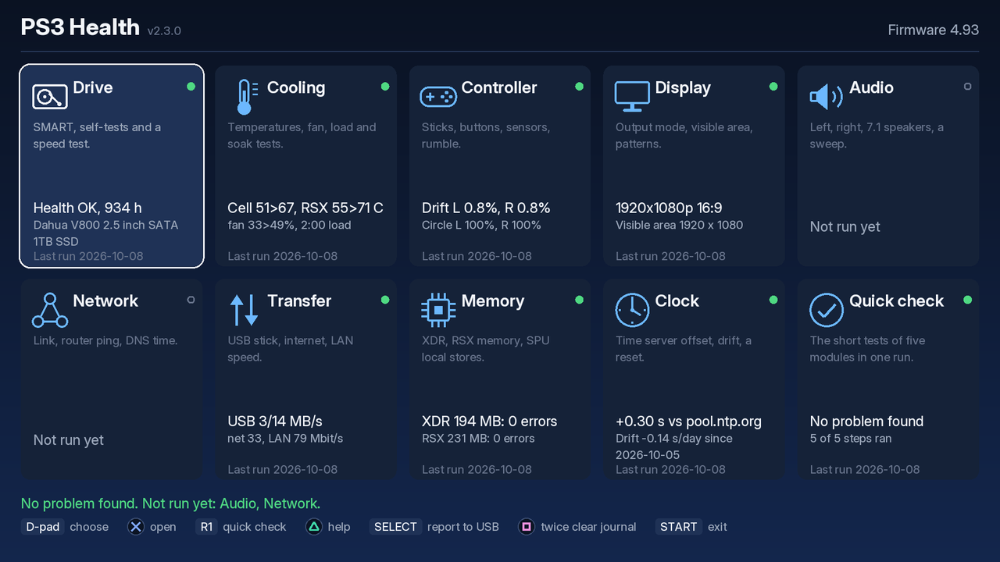<br>The home screen: what each module checks, and its last result.</td>
</tr>
<tr>
<td>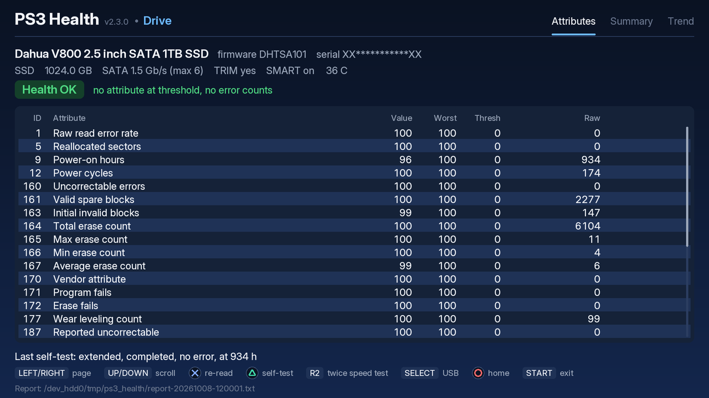<br>Drive, attributes page: the SMART table with the vendor's attribute names.</td>
<td>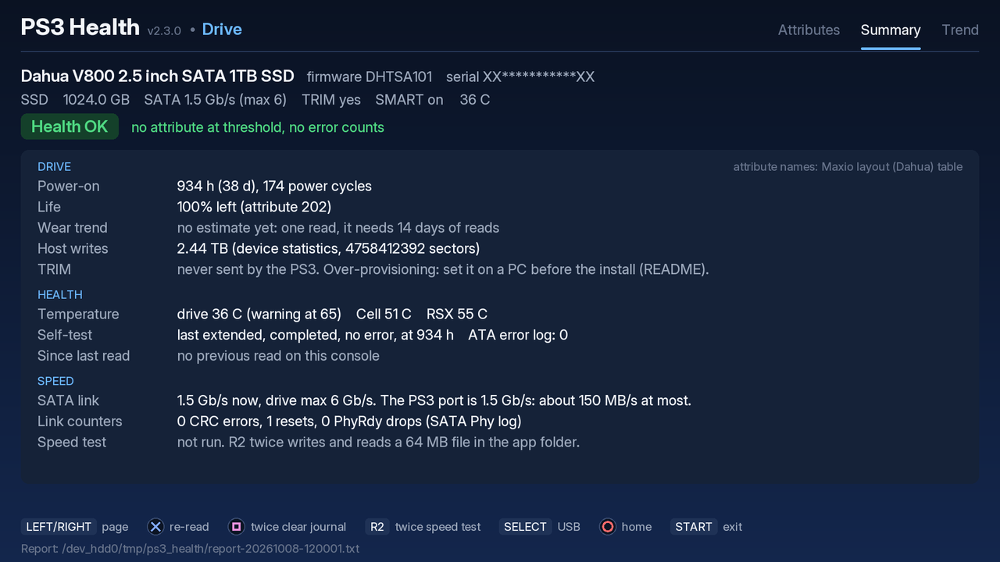<br>Drive, summary page.</td>
</tr>
<tr>
<td>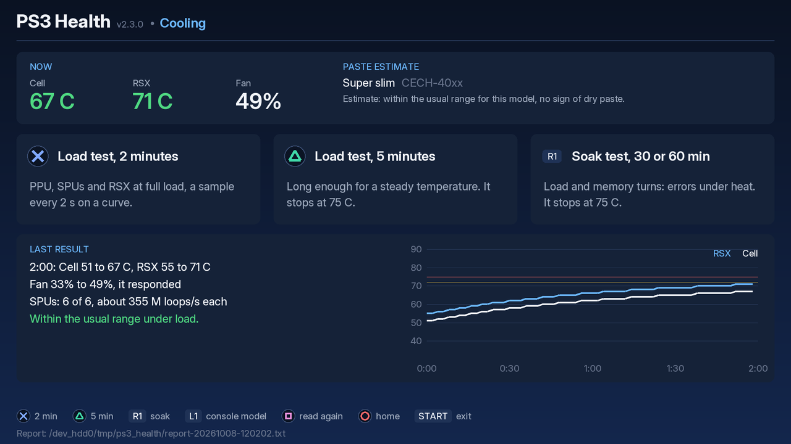<br>Cooling: a 2-minute load test, its temperature curve and the paste estimate.</td>
<td>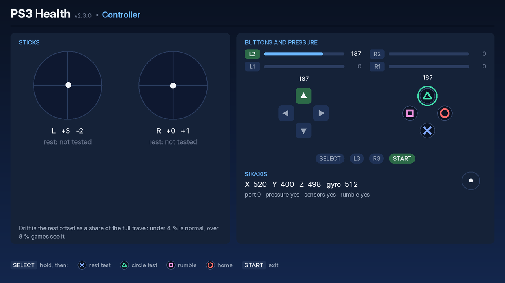<br>Controller: the sticks, every button with its pressure, the sensors.</td>
</tr>
<tr>
<td>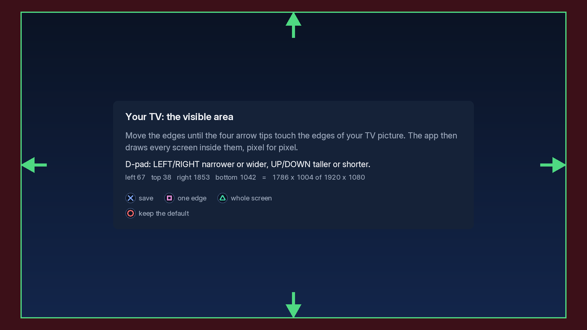<br>The visible area of your TV, asked at the first start.</td>
<td>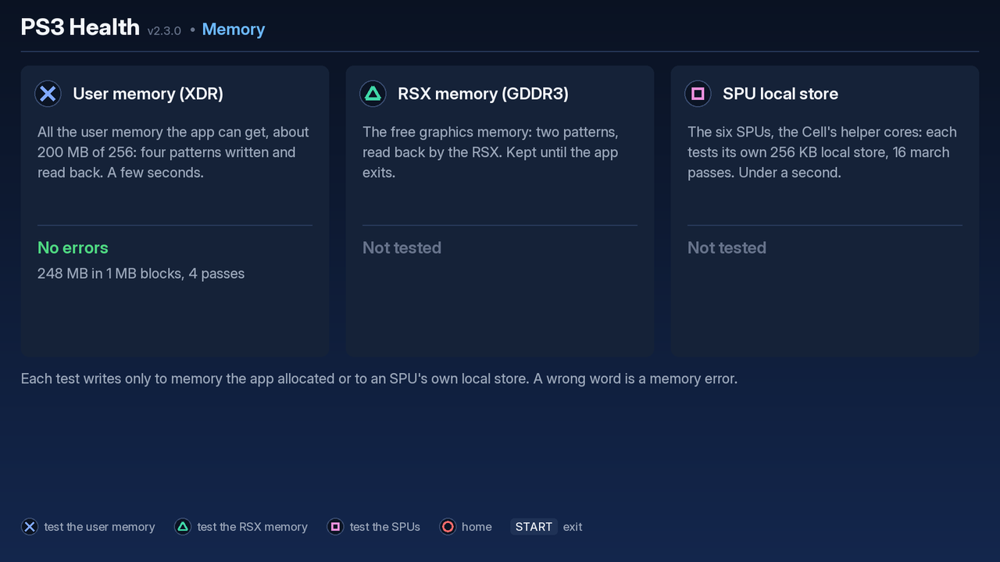<br>Memory: the user memory test passed.</td>
</tr>
<tr>
<td>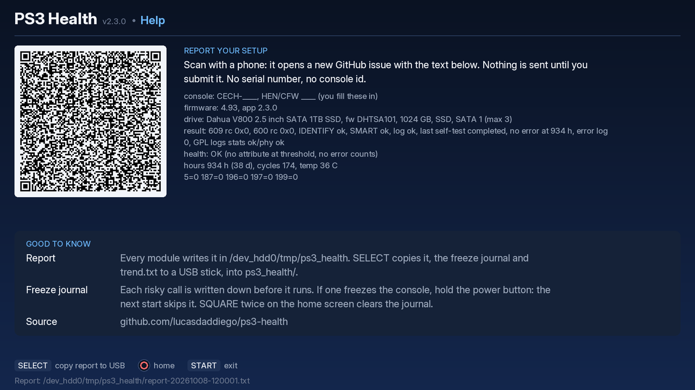<br>Help: the QR code that opens a prefilled GitHub issue, and a short guide.</td>
<td>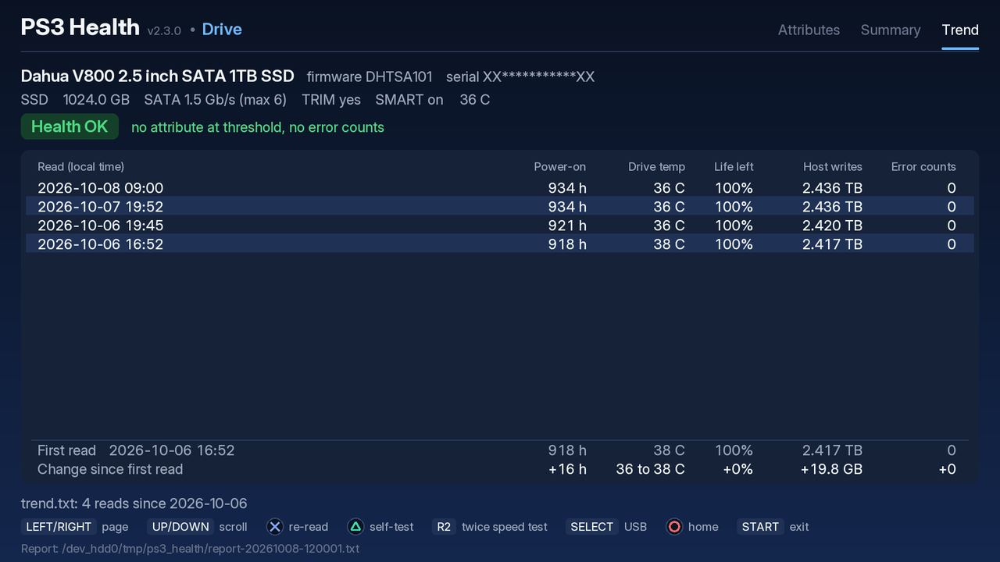<br>Drive, trend page: the full reads of this drive, newest first, and the change since the first one.</td>
</tr>
<tr>
<td>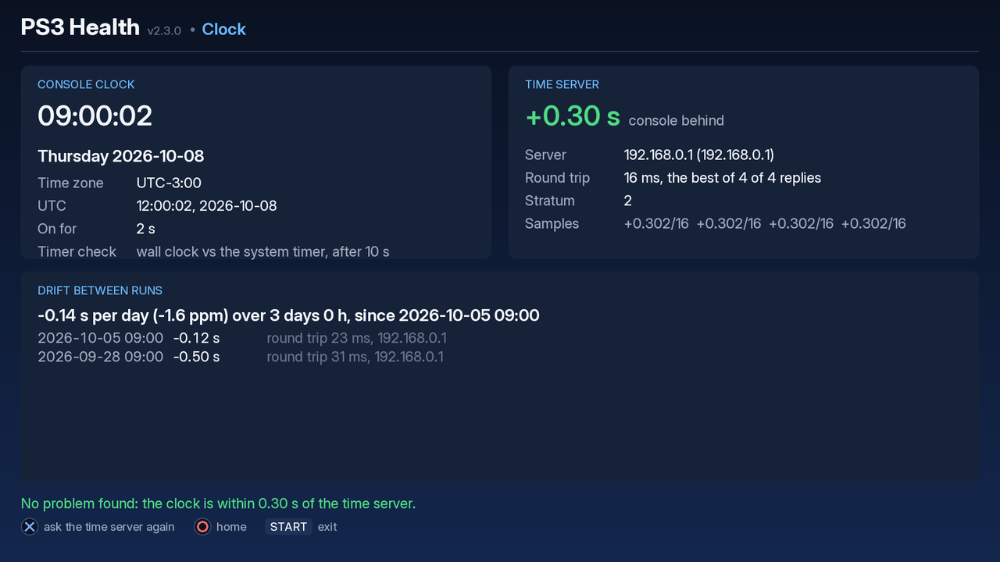<br>Clock: the console's clock against the time server, and its drift since the last runs.</td>
<td>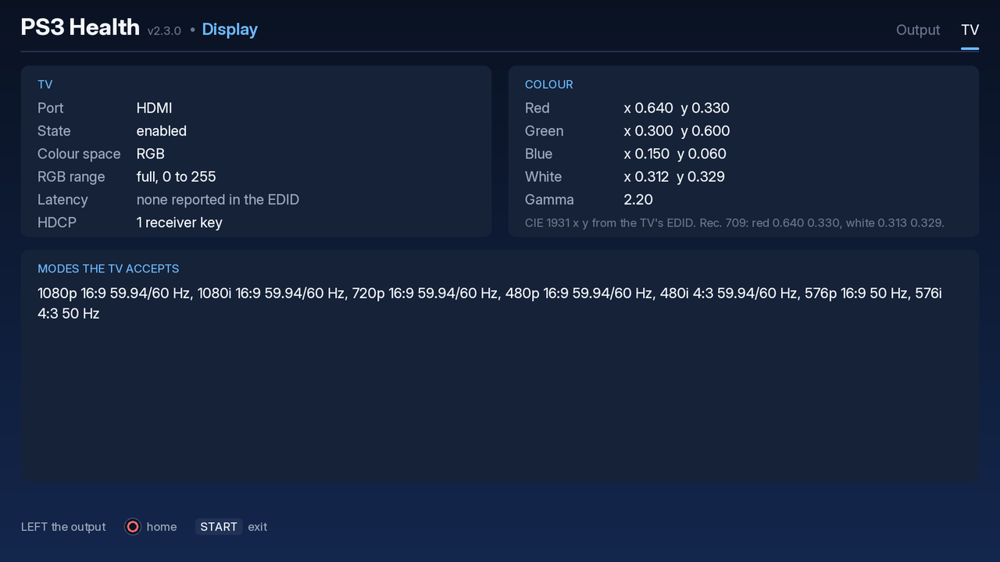<br>Display, TV page: what the TV told the console over HDMI.</td>
</tr>
</table>

## Status and compatibility

The app was tested on one console: a PS3 Super Slim on **HFW 4.93 with PS3HEN
3.6.0** and a Dahua V800 1 TB SATA SSD. The table lists the versions tested on
the console. 2.3.0 adds the Clock module (the clock against a time server,
the drift between runs, the reset warning), the TV page of the Display module
(what the TV told the console), a fifth step of the quick check (the clock)
and a tile for the quick check, so the home screen is five tiles by two.
2.2.1 is 2.2.0 on ps3gfx 57b2eb0, the library's fixes of its
two reviews of 2026-10-17: a two-press button (SQUARE twice, R2 twice) fires
only on its own button and any other button cancels it, a controller that
goes away releases its buttons, the freeze journal writes a failed record
once more, a job reads the pad in every frame (a button held through a job is
no new press after it), the visible area screen waits for a new press of an
arrow held when it opens, and the fonts' texels are white also at alpha 0
(text at 720p and 480p is brighter at its edges; 1080p keeps its pixels). The
app drops its own resets of a two-press button, which the library now makes,
and does less work per frame for the Controller's stick shapes, the Cooling
curves and the wear trend line. Five fixes of its own: the USB copy takes the
whole freeze journal (it kept the first 32 KB, the oldest records, since the
journal became append-only) and removes the stick's `journal.txt` when the
console's is empty or missing, as it does `trend.txt`; the sweep's "Done"
belongs to the sound that plays (a fill that raced a new sound could show it
at the start); the SATA phy log's size code 0 ends the list without an
undefined shift, a counter's value is 2 bytes per size code, 1 to 4 (as
smartmontools reads it: a 48-bit counter put every later one out of step, a
64-bit one ended the list), and a vendor counter (bit 15) stays apart from
the standard ids (a vendor 0x8001 overwrote the ICRC count); a model that
starts with MK is Toshiba only with a digit after it (MK1655GSX; Mushkin's
MKNSSD drives got the Toshiba table, whose attribute 241 counts 512-byte
LBAs, where a SandForce Mushkin counts GiB); and the quick check's verdict is
"Stopped" only when a step did not run (CIRCLE in the last step gave the grey
"Stopped" and hid "Not run: Network"). Faster on the console: the XDR test's read
asks for each cache line 8 lines ahead (`dcbt`), 347 to 530 MB/s, and the RSX
test's copies take 16 blocks at a time (4 when main memory is short), 126 to
201 MB/s; the load test's PPU threads run ten multiply-add chains in
registers instead of one through memory (the same heat on the author's
console). `build.sh` builds the host test with
`-Werror` and runs the speed test's file check, as CI does, and dead code and
the second copies of two text helpers are gone.

It is **not tested** on CFW (Evilnat, Rebug and others), on fat or slim models, on
other firmware versions, or on original HDDs. On another setup, a drive command
can be refused (the app then says "not supported") or it can freeze the console
(see Safety). If you try it, please open an issue with your model, firmware,
drive and the result, and it goes into this table.

### Tested on

| Model | Firmware | Drive | Version | Result | Source |
|---|---|---|---|---|---|
| Super Slim (CECH-4xxx) | HFW 4.93 + PS3HEN 3.6.0 | Dahua V800 1 TB SATA SSD | 2.3.0 | rc1 to rc3, three rounds through webMAN's virtual pad and a camera on the TV: the 5x2 home; Clock against pool.ntp.org (stratum 3, round trip 14 to 16 ms, 4 of 4 replies): the console 35.20 s ahead of the server, a yellow verdict, the timer check -7 us in 35 s (the wall clock runs from the system timer), and 25 min later the drift card: -1.47 s per day (-17 ppm); then the clock set from the XMB (Date and Time Settings, Set via Internet: "completed", so the firmware's server still answers on HEN) and rc3's Clock 30 min after: +0.38 s, stratum 2, and the drift card's "the clock was set" line with the -35.56 s step instead of a rate; the TV page (HDMI; RGB, YUV and xvYCC; full range; no EDID latency; 1 HDCP key; red 0.670 0.314, green 0.271 0.645, blue 0.152 0.054, white 0.281 0.284, gamma 2.20; 13 modes, 1080p to 480p); the quick check with its five steps in under a minute (Drive health OK at 1364 h, Cell 58 C, RSX 55 C, fan 25 %, XDR 197 MB and RSX 231 MB with no error, SPU ok, the router 1.9 ms with no loss, the clock step yellow); the journal 24 calls ok, no freeze; the exit by START; USB, LAN, Audio and Controller not run | author |
| Super Slim (CECH-4xxx) | HFW 4.93 + PS3HEN 3.6.0 | Dahua V800 1 TB SATA SSD | 2.2.1 | rc3, after the console checks of the second review's fixes (Claude's round through webMAN's virtual pad and a camera on the TV, then the author's own session): the start to the home screen; the memory tests (XDR 197 MB, read and compare 530 MB/s, was 347; RSX 231 MB read back by the RSX's copy, 201 MB/s, was 126; XDR still 197 MB after the RSX test; the six SPU local stores in 0.16 s; no errors); the 2-minute load test (Cell 61 to 68 C, RSX 57 to 63 C, 6 C a minute, fan 25 %, about 165 M loops a second on each SPU); the drive reads, SMART and a self-test to its result; Audio's tones, the 8-speaker walk and the 12 s sweep heard; Network (cable, 1000 Mbit/s full duplex, ICMP 5 of 5, 1.8 ms); internet 34.5 Mbit/s; the display (1080p, visible area 1920 x 1080); "flawless" in the author's words; rc1 and rc2 before it: the 4x2 home and the first screen of every tile but Drive and Help, the journal clear cancelled by RIGHT; USB and LAN not run | author |
| Super Slim (CECH-4xxx) | HFW 4.93 + PS3HEN 3.6.0 | Dahua V800 1 TB SATA SSD | 2.2.0 | through webMAN's virtual pad and a camera on the TV: the 4x2 home, Network (cable, 1000 Mbit/s full duplex, ICMP to the router 20 of 20, 1.9 ms, jitter 0.1 ms, DNS 27 ms), the quick check (all four steps ok in under 30 s), Audio (the 8-channel port at 48 kHz, the sweep played; no answers given), the 2-minute load test (Cell 60 to 67 C, RSX 56 to 62 C, fan 25 %) with the super slim paste estimate, the 30-minute soak (Cell 61 to 71 C, RSX 57 to 65 C, 846 memory passes and 6 SPU local-store turns, no error; rc4 with the new loops: 1266 passes, Cell 59 to 71 C, no error), the memory tests on rc4 (XDR 197 MB in kernel pages, write 782 MB/s, read and compare 347 MB/s; RSX 231 MB read back by the RSX's copy at 126 MB/s, 10 MB/s through the mapping on rc3; the SPU local stores after an XDR test, no ENOMEM), the warm-start estimate, the masked serial on the Drive screen, the life-left line ("5 days of reads, it needs 14"); the journal 135 calls ok in 43 min (rc1) and 140 in 37 min (rc4), no freeze; the controller, the display patterns, USB, LAN and the Audio answers not run | author |
| Super Slim (CECH-4xxx) | HFW 4.93 + PS3HEN 3.6.0 | Dahua V800 1 TB SATA SSD | 2.1.0 | the drive reads and SMART, the extended self-test to its result (about 43 s), the trend page, internet (34.7 Mbit/s), the memory tests (XDR 194 MB, RSX 231 MB, no errors) and the SPU local-store test (6 of 6 SPUs, no errors), the 2-minute load test with the six SPUs (about 165 M loops a second each; Cell max 65 C, RSX 60 C, fan 25 %); the journal 48 calls ok; one new start right after a full session froze the console once, not seen again in 10 later starts (after the network, memory and cooling tests, a full session, and with the files read over FTP); the controller, the display, USB and LAN not run | author |
| Super Slim (CECH-4xxx) | HFW 4.93 + PS3HEN 3.6.0 | Dahua V800 1 TB SATA SSD | 2.0.3 | an unattended round through webMAN's virtual pad: the drive read and a SMART read again, a short self-test to its result (about 24 s; the polls in their own thread), internet (35.5 Mbit/s; the network started behind the counter), the 2-minute load (Cell 58>60 C, RSX 55>60 C, fan 25 %), the time zone read (-180 min); the journal 21 calls ok, no freeze; the controller, the display, USB, LAN and the memory tests not run | author |
| Super Slim (CECH-4xxx) | HFW 4.93 + PS3HEN 3.6.0 | Dahua V800 1 TB SATA SSD | 2.0.2 | the first build on the ps3gfx library, at 1080p: the drive reads, the speed test (24/62 MB/s) and the start of the extended self-test, the temperatures and the fan duty under the 2-minute load (Cell 56>57 C, RSX 52>58 C, fan 25 %), the display and the visible area, internet (32 Mbit/s) and LAN (82 Mbit/s), the memory tests (XDR 194 MB, RSX 231 MB, no errors), Help, Quit Game; the journal and the status page followed over FTP and HTTP by ps3run for the whole run (12 min in game, no freeze); USB and the controller not run | author |
| Super Slim (CECH-4xxx) | HFW 4.93 + PS3HEN 3.6.0 | Dahua V800 1 TB SATA SSD | 2.0.1 | the six modules at 1080p with the app's own renderer: the drive reads, the speed test (24/61 MB/s) and a short self-test, the temperatures and the fan duty under load, the controller, the display and the visible area, internet (33 Mbit/s) and LAN (77 Mbit/s), the memory tests (XDR 194 MB, RSX 231 MB, no errors), Help with the QR code, Quit Game and a new start; USB not run (no stick) | author |
| Super Slim (CECH-4xxx) | HFW 4.93 + PS3HEN 3.6.0 | Dahua V800 1 TB SATA SSD | 2.0.0 | the six modules at 1080p: the drive reads and the speed test, the temperatures and the fan duty, the controller (drift 0.8 %, circle 100 %), the display and the visible area, USB (3/14 MB/s), internet (33 Mbit/s) and LAN (79 Mbit/s), the memory tests (XDR 194 MB, RSX 222 MB, no errors), Help with the QR code | author |
| Super Slim (CECH-4xxx) | HFW 4.93 + PS3HEN 3.6.0 | Dahua V800 1 TB SATA SSD | 1.3.0 | all of 1.2.0, plus the extended self-test (three runs, about 2 min each on this SSD, all passed) and the pickup of a test that is still running at the next start | author |
| Super Slim (CECH-4xxx) | HFW 4.93 + PS3HEN 3.6.0 | Dahua V800 1 TB SATA SSD | 1.2.0 | all of 1.1.0, plus the error log and the two general purpose logs (device statistics, Phy counters) | author |
| Super Slim (CECH-4xxx) | HFW 4.93 + PS3HEN 3.6.0 | Dahua V800 1 TB SATA SSD | 1.1.0 | IDENTIFY, SMART reads, the short self-test, the speed test (write 25, read 63 MB/s), USB copy, QR scan and demo mode work | author |
| Super Slim (CECH-4xxx) | HFW 4.93 + PS3HEN 3.6.0 | Dahua V800 1 TB SATA SSD | 1.0.1 | IDENTIFY, SMART reads and the short self-test work | author |

An issue report needs: the model line of the console, the firmware and HEN/CFW
version, the drive (from the Drive module or the report), the app version, and
what happened (works, "not supported", or a freeze and at which step). The QR
code on the Help screen (TRIANGLE on the home screen) opens a new issue with
all of it filled in except the console model and the HEN/CFW version (a blank
issue, not the
[issue form](../../issues/new?template=compat-report.yml): the GitHub mobile app,
which catches the link on a phone, fills only title and body). The report file
ends with the same text.

## Install

1. Download `PS3-Health-v2.2.0.pkg` from [Releases](../../releases).
2. Copy it to `/dev_hdd0/packages/` (FTP), or to the root of a FAT32 USB stick.
3. With HEN on, install it: Game → Package Manager → Install Package Files (Standard
   or USB).
4. Start **PS3 Health** from the Game column, with no game running.

## Use

At the first start the app asks for the visible area of your TV: move the
edges until the four arrow tips touch the edges of the picture (D-pad: both
sides together; SQUARE: one edge at a time), then CROSS. CIRCLE keeps the
default, 93 % of the screen. The Display module can change it later.

The home screen: ten tiles, five by two, one per module and one for the quick
check, each with what it checks, a
dot (green ok, yellow check, red problem, hollow when it never ran),
two lines from the last result and its date (in the console's time zone), and
a verdict line under them. D-pad chooses (LEFT and RIGHT wrap around a row, UP
and DOWN change the row), CROSS opens a module, CIRCLE in a module goes back
home, START exits. R1, or CROSS on its tile, runs the quick check (below). TRIANGLE opens Help: the QR code of the compatibility
report (it opens a prefilled GitHub issue on a phone; nothing is sent until
you submit it) and a short guide. SELECT copies the report, `journal.txt` and
`trend.txt` to the first USB stick found, into `ps3_health/`. When the console
has no `journal.txt` or `trend.txt` (or an empty one, as the journal after
SQUARE twice), the copy removes the one on the stick, so the folder holds no
journal or trend of another console. The copy is journaled:
after a freeze inside it, SELECT copies nothing until the journal is cleared.
SQUARE twice clears the freeze journal (see Safety). The button line at the
bottom of each screen shows the controller's own symbols.

### Quick check

R1 on the home screen (or CROSS on the quick check tile) first shows the five
steps; CROSS runs them in order, each with the module's own code and journal
entries:
1. Drive: the drive read of the session, or a new SMART read (no self-test,
   no first-run prompt of the optional logs).
2. Cooling: the temperatures and the fan duty at rest.
3. Memory: one pass over the user memory (XDR) and the RSX memory, the first
   two patterns block by block in turns (so every bit is written as 0 and as
   1), then the SPU local-store test.
4. Network: the connection data and five pings to the router. When the
   network did not start (or its start froze before), the step runs no test
   and shows "not run" with no dot, as the module gives no verdict then.
5. Clock: one exchange with the time server (four packets, about a second),
   the clock's offset and its drift since the last run. Without the network,
   as the Network step.

A first-run prompt that was never answered (the fan, the SPUs) comes before
the run. The steps run behind a counter; CIRCLE stops after the step that
runs (that step runs to its end), and the rest show "not run". CIRCLE during
the last step skips nothing: the verdict is the normal one. One verdict
screen lists each step with its dot and result, and each module's tile changes
as after a normal run (one write of `state.txt` for all five and the check's
own tile, which keeps the verdict and the number of steps that ran). The whole
check takes under a minute (under 30 s on the author's console). Without a writable
app folder there is no journal, and R1 does nothing.

### Drive

1. The first screen offers **CROSS** to read the drive and TRIANGLE for demo
   mode. The app writes each step to the journal before it runs it.
2. Three pages (LEFT/RIGHT): the attribute table, a summary and the trend.
   The header above them shows the serial number masked, as the report does.
   - UP/DOWN scroll the table and the trend, L1/R1 by a screen.
   - CROSS reads the drive again. Rows whose raw value changed since the
     previous read turn blue.
   - The summary page has the SSD's **wear trend**: a straight line through
     the life left of the reads in `trend.txt` (least squares over the days,
     one point a day: the last read of each day) gives "about N months to
     0 %", once the reads span 14 days and life left dropped by a point or
     more; past 10 years it says "over 10 years". Until then it says why there
     is no estimate (one read, too few days, no drop). The dates come from the
     console clock: a read dated before an earlier one (the clock was set
     back) is left out, and when the newest read is such a read there is no
     estimate, with that reason. It is a rough guide: wear is not linear, and
     the attribute counts in whole points. The report has the same line. At
     the smallest visible area it shares the life row.
   - The trend page lists the full reads of this drive from `trend.txt`,
     newest first: the local date and time, the power-on hours, the drive
     temperature, the life left, the host writes and the sum of the error
     counts. Two rows at its foot hold the first read and the change since
     then. Each full read adds a line: the read at the open, CROSS, and the
     read when a self-test ends. A drive with another model starts the file
     again.
   - TRIANGLE offers a self-test: CROSS for the short one (about 1–2 min),
     TRIANGLE for the extended one (the whole surface; the drive states the
     minutes, often 60 or more). It runs on its own screen: a progress bar, a
     seconds counter, then the result. Any other button goes back to the table
     while the drive continues; TRIANGLE returns to the test screen. START and
     CIRCLE are blocked while a test runs: the drive is busy with the test, and
     the console becomes very slow until it ends (seen on a PS3 Super Slim
     during the extended test). Quit Game from the PS button still exits; the
     next start then finds the test running and shows its progress, then the
     result. Neither test can be aborted from the app. The result comes from
     the new entry in the drive's self-test log, not from a timer: a drive that
     accepts the command but never runs the test shows "no progress" in
     yellow, not a pass.
   - R2 twice runs the speed test: a 64 MB file written in 1 MB pieces in the
     app folder, read back and deleted, both rates shown. This goes through
     the file system, the path games use. The PS3's SATA port is 1.5 Gb/s, so
     about 150 MB/s is the most any drive shows here.
3. Demo mode shows the sectors saved in `demo/` and never touches the drive
   ("DEMO" in the title). Reports go to `demo-report-*.txt`. Demo reads add no
   line to `trend.txt`.

### Cooling

The Cell and RSX temperatures (syscall 383) and the fan duty (syscall 409,
`sys_sm_get_fan_policy`, the read half of what webMAN uses; behind a first-run
prompt; the module stays closed when the app cannot write its journal). CROSS
runs a 2-minute load test, TRIANGLE a 5-minute one: two PPU threads at full
load, the six SPUs on the app's own heat program (multiply-add chains that
keep the float pipeline busy), and the RSX drawing 160 full-screen layers per
frame; the temperatures every 2 s on a curve, then the peak values, the fan
response and the rate of each SPU in millions of loops a second. CIRCLE stops
the test early and keeps the curve. At rest, the tile and the quick check
turn yellow when the hotter chip is more than 3 C over the idle limit of the
console model (below), or at 70 C with no model set.

The SPUs start and stop behind the counter, every call journaled. Their
first-run prompt, shared with the Memory module's SPU test, comes at the
first load test (see Safety). A skip runs the load test without the SPUs, and
so does a start that fails or that froze the console before: the screen says
which.

The test stops by itself, with a yellow result that names the reason:
- when the Cell or the RSX reaches 75 C;
- after two failed temperature reads in a row;
- when an SPU stops reporting (its count did not move from one reading to the
  next, 2 s later).

The verdict compares the peak with the usual range seen on a PS3 with clean
cooling: under 72 C ok, 72 C and above "warm, clean it". The test stops at
75 C, so no result is red. The console protects itself and shuts down near
85 C. The app never writes to the fan.

**Console model and paste estimate.** The first open asks once for the
console family: fat (CECHA to CECHQ), slim (CECH-20xx to 30xx) or super slim
(CECH-40xx), from the label at the back. CIRCLE skips it; L1 changes it later.
The answer goes into `family.txt`. After each test the module compares four
values with that family's usual range: the hotter chip before the load, its
peak in the first 2 minutes (the ranges come from 2-minute tests; the result
and the report also give the peak of the whole test), its rise over the first
60 s (C a minute, taken once at 60 s) and the fan duty at the end. None above
the range: "no sign of dry paste"; one: "dust or old paste is possible"; two
or more: "dry paste or dust is likely". A test that reaches 75 C within its
first minute gets "likely" at once. It is an **estimate**, and the screen says
so. The ranges are provisional, in one table in `source/heat.c`:

| Family | Idle | Peak | Rise in the first minute | Fan at the end |
|---|---|---|---|---|
| Fat | 62 C | 74 C | 14 C | 70 % |
| Slim | 56 C | 72 C | 12 C | 60 % |
| Super slim | 59 C | 72 C | 12 C | 60 % |

A test that starts warm says less about the paste: a load test that starts
less than 10 minutes after the end of the last one in this session, or more
than 3 C above the reading taken when the module opened, is a **warm start**.
Then the idle value and the rise leave the estimate (it uses the peak and the
fan), and the screen says to rest about 10 minutes for a full estimate.

The super slim row comes from one console (the author's: its cold idle reads
56 to 58 C, its load test with a margin); the fat and slim rows are guesses
from the chips' generations, not measured. The compatibility text (Help's QR
code and the report) carries a Cooling line after a load test: the family, the
idle and peak temperatures, the rise, the fan and the test length, and no
identifier. Reports with it will set real ranges. When Help's link would not
fit the QR code, the line gets shorter (the family, idle, peak and rise), then
goes.

**Soak test.** R1 offers 30 or 60 minutes of turns: a load turn of 4 minutes
(two PPU threads, the six SPUs on the heat program, the RSX fill), then a
memory turn of 1 minute while the chips are warm (the six SPUs test their
local stores once, then a PPU thread writes and checks the Memory module's four
patterns over 64 MB of user memory, while the RSX keeps its load). Only one
SPU group runs at a time: the heat group ends before the local-store test.
The soak keeps the load test's stops (75 C, two failed reads, an SPU that stops
reporting during a load turn), checked at every reading, every 2 s, and CIRCLE
stops it cleanly. The curve keeps its 400 points by halving them when full
(each pair becomes its higher value), so an hour fits; a point is then the
highest of its readings. Every turn runs its full length: the jobs of a turn
change (the SPU start and stop, the local-store test) pause the soak's clock,
and their few seconds are a gap in the curve. Each turn is one journal entry
(`soak_load`, `soak_mem`) from its start to its end; a freeze inside keeps the
soak off until the journal is cleared. A memory error under heat is a red
result, and so are SPUs of a local-store test that could not be stopped (the
soak ends there); a local-store test that did not end is a yellow one. The
result card shows the memory passes, the local-store tests and their errors.

### Controller

Live view of both sticks, every button with its pressure value, L2/R2 bars,
the sixaxis values with a level bubble. Every button only lights up here, so
START and CIRCLE can be tested too; the actions need SELECT held. SELECT +
CROSS runs the rest test: three seconds without touching the sticks give the
mean offset from the centre (drift, as a percentage of full travel: under 4 %
is normal, over 8 % games see it) and the noise. SELECT + TRIANGLE runs the
circle test: turn both sticks around their full edge for 8 s, and the app
shows how much of the circle each stick reached. SELECT + SQUARE runs the
small motor, then the large one. SELECT + CIRCLE goes home, SELECT + START
exits.

### Display

The output mode (resolution, scan, aspect, color space, refresh). CROSS
adjusts the visible area, as at the first start (L1/R1 choose the edge in the
one-edge mode, TRIANGLE takes the whole screen). TRIANGLE shows the test
patterns: white, black, red, green, blue (dead and stuck pixels), a 16-step
gray ramp, a crosshatch with a circle for geometry and aspect, 1-pixel stripes
(at 1080p, even stripes mean the TV shows every pixel; moire bands mean it
scales the picture, overscan on), and a lag pattern with a millisecond timer
and a moving bar to film next to the source; CROSS there flashes one white
frame.

RIGHT opens the TV page: what the TV told the console when it was connected,
read once per session through the system's video library (journaled as
`display_tv`). The port (HDMI, component, composite, D-terminal, RGB, SCART,
D-sub), its state, the colour space (RGB, YUV, xvYCC), the RGB range (full,
0 to 255, or limited, 16 to 235), the latency the TV's EDID declares (most
declare none), the number of HDCP receiver keys (the count only), the colour
primaries and the white point as CIE 1931 x and y (fractions of 1024 in the
EDID; Rec. 709 is red 0.640 0.330, white 0.313 0.329) with the gamma, and the
list of modes the TV accepts (resolution, progressive or interlaced, aspect,
refresh rates). The report has the same lines. The system's library gives no
TV name and no audio device data: the page says what it cannot show.

### Audio

Every sound plays at -18 dBFS with a fade at each end, so nothing clicks; set
the TV to a normal volume first. After each sound you answer CROSS heard or
CIRCLE not heard; TRIANGLE stops the test.
- CROSS: 440 Hz beeps on the left speaker, then on the right. Each beeps until
  you answer.
- TRIANGLE: the speaker walk, the eight channels of an 8-channel port one by
  one (front left, front right, centre, the subwoofer at 50 Hz, surround left
  and right, back left and right), each named on screen and shown on a plan of
  the room. On a stereo TV the system mixes the extra channels into the two
  speakers and may drop the subwoofer: "not heard" there is no fault.
- SQUARE: one tone from 20 Hz to 20 kHz in 12 s on both front speakers, even
  on a log scale. Most ears stop near 15 kHz; a rattle or a buzz on the way is
  a speaker or a cable.

The app opens one port of the system's audio library: eight channels at
48 kHz when the system gives them, else two (then no walk, and the screen says
so). A thread keeps the port's ring of 16 blocks filled 7 blocks (about
37 ms) ahead of the read. The start (the audio module, the library, the
port) is one journaled call at the first
test, behind the counter; the end (the port stop and close, the library, the
module unload) is another, at every way out of the module and once more at the
exit. Before the end the sound that plays fades out in 40 ms and the port
plays it out, so leaving never clicks. An end that froze the console before is
not made again: the port stays open and silent, and a later test in the same
session plays on it. The tile and the report keep each answer; a test stopped
with TRIANGLE before its last answer counts as "not answered", yellow. Without
a writable app folder the module stays closed.

### Network

The connection as the system's netctl library reports it: cable or Wi-Fi, the
link speed and duplex on a cable, the signal (in %) and the channel on Wi-Fi,
the MTU, the console's address (DHCP or static), the router and the DNS
servers. The MAC address is never read. CROSS sends 20 pings to the router and
looks up `example.com` (a name kept for examples, on every DNS server) once,
timed. The verdict: no address or no answer is a problem; a loss over 5 %, a
Wi-Fi signal under 40 %, a cable link under 1000 Mbit/s full duplex, an
average over 20 ms, a jitter over 10 ms, a failed DNS lookup or one over
300 ms is a check. These limits are for the router on the same network, not
the internet.

A ping is an ICMP echo on a raw socket, one journaled call (`ping_icmp`) from
the socket to its close. When the system refuses the raw socket, the router
does not answer the first three, the journal says ICMP froze before, or there
is no journal, the ping is the time of a TCP connect to the router's port 80
(53 when 80 gives nothing): its answer, a connection or a refusal, is one
round trip too. The screen and the report say which method ran and why. The
network starts as in Transfer, as the same journaled call, and the netctl
reads of the connection data are one more (`net_info`): reads that froze the
console are not made again until the journal is cleared.

### Transfer

CROSS: the 64 MB file test on the first USB stick found. TRIANGLE: a 50 MB
download over plain HTTP from `speed.cloudflare.com` (another `http://` URL
goes in `net_url.txt` in the app folder; no https). SQUARE: the app listens
on TCP port 5201 for two minutes and shows its address and the command for
the PC (`nc <address> 5201 < /dev/zero`); it receives for 10 s and shows the
rate. A download counts only when the whole file arrived. The wired port is
1 Gbit/s on every PS3, Wi-Fi is 802.11g.

The first open starts the network behind the counter, as one journaled call.
Without a writable app folder there is no journal, so no skip can follow a
freeze, and the start runs with no counter. If the start froze the console,
the app never runs it again: the title line says so, and the internet and LAN
tests fail with that reason. The exit ends the network (`netCtlTerm`,
`netDeinitialize`, the netctl module) as one journaled call and waits for it
about 3 s at most; if it froze the console, later exits skip it. Without a
writable app folder the exit makes no network call.

### Memory

CROSS takes all the user memory (XDR) the app can get in 1 MB blocks, about
200 MB of the 256, writes four patterns (address based, its inverse,
alternating bits, a linear congruential sequence) and reads each back, in a
few seconds. A wrong word is an error, listed with its address. TRIANGLE does
the same on the free RSX memory (GDDR3) through its mapping, two patterns, in
under a minute; the blocks stay taken until the app exits (the RSX allocator
gives nothing back). Both write only to memory the app allocated. CIRCLE stops
a test. The loops keep each pattern as a running value (no per-word branch)
and clear each 128-byte cache line with `dcbz` before writing it, so a write
does not first read the line from memory; the read asks for the line 8 lines
ahead (`dcbt`), so the next lines arrive while it compares; the report gives the write and the
read speeds of each test in MB/s (`-DMEM_LINES=0` in the Makefile's `CFLAGS`
builds the 2.1.0 loops, to compare).

The RSX test writes through the mapping, and reads back by the RSX's own DMA
(ps3gfx's `gfx_copy_to_main_job`): the RSX copies 16 blocks at a time (4 when
main memory has no 16 MB for them) into main memory between two frames, because a read through the mapping takes
about 0.5 us. The first use in a session is a self-check, journaled as
`rsx_dma`: the RSX's copy of a written block must equal the block read
through the mapping. A block whose copy differs from its pattern is read
again through the mapping, and that read decides; if the mapping reads no
wrong word there, the DMA turns off. A frozen `rsx_dma` (the next start
skips it), a failed check, a failed copy, or no writable app folder: the
reads go through the mapping in 64 KB copies, as before. The report says
which path read (`read: dma`, `read: ppu`, or `read: dma, then ppu`) and why
the DMA was off. `-DMEM_DMA=0` builds the test without the DMA.

The XDR test and the soak's memory turns take their 1 MB blocks as kernel
pages (`sys_memory_allocate`, syscall 348) and give each back at the end
(`sys_memory_free`, 349). With malloc, newlib's heap kept the memory it grew
to: on 2.2.0 rc3, a quick check after a full XDR test could not create the
SPU group (`ls_group` rc 0x80010004, out of memory). So the tests run in any
order in one session. The XDR test still gives 8 MB back at once, as
headroom for the app's own heap. When the kernel refuses the first page, the
blocks come from malloc as before; the report names which (`1 MB kernel
pages` or `malloc blocks`).

SQUARE tests the local store of each of the six SPUs, the Cell's helper
cores. The app runs its own SPU program (ps3gfx's SPU kit) as one group of
six SPU threads, and each thread tests about 234 KB of its own 256 KB local
store: all of it but the program and the top 16 KB, which the stack keeps. A
pass is March C- on two backgrounds, then a write and a read of each word's
own local-store address XOR a constant that changes with the pass; the test
makes 16 passes. It should take well under a second
(an estimate from its instruction count: the report has the time the SPUs
measure). A wrong read is an error, shown with its SPU, its local-store
address, the word written and the word read. The SPU test cannot be stopped
with CIRCLE: the app waits up to 5 s for its end, then stops the SPUs
itself. The first use of the SPUs, here or in the Cooling load test, asks
before they run (a first-run prompt, see Safety). Without a writable app
folder there is no journal, and the SPU test does not run.

### Clock

The console keeps its clock on a small battery; when it goes flat (old
consoles), the clock starts at 2000 and the system asks for the date at each
boot. The module checks the clock against a time server and keeps the result,
so the next run shows the drift.

The open starts the network (as Transfer and Network do) and asks the time
server: four NTP packets over UDP to port 123, 1.5 s each, 200 ms apart; the
reply with the shortest round trip counts (RFC 5905: the offset is the
server's clock minus the console's, the round trip the time on the wire,
measured on the system timer). The server is `pool.ntp.org` through the
console's resolver, or the first line of `ntp.txt` in the app folder (a name
or an address). CROSS asks again. The exchange is one journaled call
(`clock_ntp`); a server that answers with a kiss-o'-death (stratum 0) ends
it. The screen: the local time (the console's zone setting, as the report's
console line), the UTC time, the time since power on, the offset large with
the server, its address, the round trip, the stratum and the four samples;
after 10 s a timer check, the wall clock against the system timer since the
open (a difference means the system runs the clock from another source than
its timer). Each result is one line in `clock.txt`; the drift card compares
the new offset with the last line (at least 10 min apart): seconds per day
and parts per million, positive when the console's clock runs fast, over the
span since that line, and lists the last results. A rate past 200 ppm (a
quartz clock stays under 50) means the clock was set between the runs: the
card says so with the step, and the drift starts again from this result.

The verdict: no problem within 2 s of the server; check past 2 s, or when
no reply came (port 123 is blocked on some networks); problem past 60 s, or
when the clock is before 2010 (no PS3 firmware is older: the clock was
reset), each with "set the date and time in the system settings". The tile
keeps the offset and the drift. The report section `clock` has the console's
clock, the zone, the server and its samples, the drift and the verdict.

### Files on the console

In `/dev_hdd0/tmp/ps3_health/`:
- `report-YYYYMMDD-HHMMSS.txt` — one report per write (UTC time): the console
  line (the firmware, the temperatures, the time zone setting: TIMEZONE in
  minutes and SUMMERTIME), then a section per module with a result. The drive
  serial number is masked (`AB******78`). The drive section ends with the
  compatibility text.
- `state.txt` — the last result of each module, for the home screen.
- `compat.txt` — the compatibility text of the last Drive result. Help shows
  it until the Drive module runs in the session.
- `safe_area.txt` — the visible area, in 1920 x 1080 units.
- `family.txt` — the console family for the paste estimate: `fat`, `slim`,
  `superslim`, or `unknown` when the question was skipped.
- `net_url.txt` — optional, the `http://` URL for the download test.
- `ntp.txt` — optional, the time server of the Clock module (a name or an
  address) instead of `pool.ntp.org`.
- `clock.txt` — one line per answer of the time server: the console's clock
  (UTC seconds), the offset and the round trip in ms, the server
  (`1791460801 301 16 pool.ntp.org`). The Clock module reads the last 16 KB;
  a file that reached it starts again from its last 8 lines.
- `identify.bin`, `smart.bin`, `thresh.bin`, `selftest.bin`, `errlog.bin`,
  `devstat.bin`, `phy.bin`, `devinfo.bin` — the raw sectors of the last drive
  read. `identify.bin` holds the full serial number and the WWN: do not attach
  it to a public issue.
- `smart.when` — the time and the model of the last `smart.bin`, for the
  "since last" column. A different model gives no delta.
- `trend.txt` — one line per full drive read, oldest first, under a first line
  `drive <model>`: the local date and time, the power-on hours, the drive
  temperature in C, the raw value of the host-writes attribute, the life left
  in % and the sum of the error counters, with -1 for a value the drive does
  not report (`2026-10-07 19:52 934 36 72607 100 0`). Another drive starts the
  file again. A file that the app cannot read gets no new line: the trend page
  shows the rc, and a delete over FTP starts the file again. The trend page
  reads the first read and the last 8 KB.
- `journal.txt` — the freeze journal (below).
- `boot.txt` — the boot log: it records the last start step reached, so a
  start that stops can be found. Over 32 KB, the next start moves it to
  `boot.old.txt` and begins a new one.
- `gfx_init.txt` — written only when the app cannot start its picture: the
  number of the renderer's init step that failed (`gfx_be_init` in ps3gfx's
  `source/gfx/gfx_rsx.c`). The app then goes back to the XMB.
- `demo/` — put `identify.bin`, `smart.bin` and, if you have them, `thresh.bin`
  and `selftest.bin` here for demo mode. This is how a dump from an issue is
  reproduced, and how the Drive screenshots are taken.

## Safety

The Drive module sends only these ATA commands:
- IDENTIFY DEVICE;
- SMART READ DATA, READ THRESHOLDS and READ LOG 06h (the self-test log);
- SMART EXECUTE OFF-LINE IMMEDIATE, subcommand 01h (short self-test) or 02h
  (extended self-test), both in off-line mode, and only after TRIANGLE and
  your choice on the self-test screen;
- behind a first-run prompt (the app shows what the command does and asks for
  CROSS before it runs the first time; CIRCLE skips it, and the skip is kept
  until SQUARE twice clears the journal): SMART READ LOG 01h, the summary error
  log; and READ LOG EXT 2Fh on a drive with General Purpose Logging, the device
  statistics log (04h, pages 1, 5 and 7) and the SATA Phy event counters log
  (11h). Up to five 512-byte reads.

A note on what the path cannot do: the system call returns the data buffer
and a status word, not the drive's registers. A non-data command whose answer
is in the registers, like READ NATIVE MAX ADDRESS EXT, comes back empty (tested
on the author's console: accepted, no registers). So the app cannot tell
whether a Host Protected Area is set.

It never sends a write, a standby, a captive self-test or a SMART enable/disable.
The self-tests do not change data: the drive checks itself and keeps serving
normal I/O. The extended one reads the whole surface, so it takes long and
slows the drive while it runs.

The other system calls, all read-only and journaled like the drive calls:
383 `sys_game_get_temperature` (Cell and RSX) and, behind a first-run prompt,
409 `sys_sm_get_fan_policy` (the fan duty). The speed and USB tests use the
normal file calls, the Transfer and Network modules the normal socket calls
(the Network module's ping a raw ICMP socket, else a TCP connect) and the
netctl reads, the Memory
module's XDR and RSX tests and the soak test's memory turns their own
allocations, the Display module the video state read and the TV data read,
the Clock module a UDP socket to the time server, the Audio module one
port of the system's audio library (calls into the firmware's library, not
syscalls). The network start (the first open of Transfer, Network or Clock),
its end at the exit, the Network module's connection reads, the ICMP run, the
Clock module's exchange (`clock_ntp`), the TV data read (`display_tv`), the
audio start and end, each turn of the soak test and the copy to a USB stick
(SELECT) are journaled too. (Raw sector
reads, syscall 602, and the console id, syscall 870, are refused on HEN: ENXIO
and EPERM on the test console. The app does not call them.) The build checks
this: `tools/syscalls.py` scans the ELF for every syscall number and fails on
602, 604 or 870, or on a number outside `tools/syscalls.allow`.

The Memory module's SPU test and the Cooling module's load and soak tests run
the app's own program on the six SPUs (the soak one group at a time), behind one first-run prompt (asked at the
first use in either module; a skip is kept until SQUARE twice clears the
journal). They use LV2's SPU calls: 169 `sys_spu_initialize` (once per start
of the app), 170 to 173 (create the SPU thread group, destroy it, a thread in
it, start it), 177 and 178 (terminate and join the group) and 165 (a thread's
exit status, in the Memory test), plus the image import and close, which are
calls into the firmware's library. Each call is journaled, and so is each
test while the SPUs run, under the test's own names: a freeze in the Memory
test keeps that test off, a freeze in the load test keeps the SPUs out of the
load test (it runs without them), and a freeze in the image calls or in a
terminate keeps both off, until the journal is cleared. The SPUs write only
to their own local stores and one 128-byte report each in the app's memory.
The app ends the group itself: the join only after each thread reported its
end, else a terminate first (the load test always ends this way), so it
never waits on a thread that can still run. A group that does not stop stays
up, and the screen says so in red: the SPUs then stay off in both modules
until the app exits (no other load test runs on top of them), and the exit
makes one more terminate. A group that ended but could not be destroyed
keeps them off too, with that reason. While the SPUs heat the console, the
load test's own stops (75 C, two failed reads, an SPU that stops reporting)
are the app's only guard; the console's fan control and its shutdown near
85 C work as always.

Sending ATA commands to the internal drive from a PS3 app was new ground. While
we tested, one other method (syscall 604 with LV1 command 0x22) **froze the
console**, and only a forced power-off recovered it. The release uses only the
method that worked. Because another firmware can behave differently, the app
writes each journaled call to `journal.txt` (synced) before it runs it. If the
console freezes inside a call, the next start finds the call without a "done"
line and never runs that call again. Each such call runs in its own thread while
the screen shows a seconds counter: a counter that stops is a frozen console.
After a forced power-off, let the console check its file system at boot if it
offers to, and never choose "Restore PS3 System".

The app reads the complete journal with bounded memory, so older frozen and
skipped calls remain blocked after long sessions. Journal records stay
append-only until you explicitly clear them. If a record cannot be written or
synced, the call still runs, but a freeze during it may go unrecorded. A `skip` line records a command you
declined at its first-run prompt. To try a skipped or frozen call again (for
example after a firmware change), press SQUARE twice on the home screen: the
journal is emptied, and the next start asks or runs every call again.

## SSD in a PS3: no TRIM

The PS3 firmware predates TRIM and never sends it, on any model or firmware.
The app shows "TRIM yes" only as a drive capability. Without TRIM, the SSD's own
garbage collection does all the work, and it can only reuse blocks it knows are
free: its spare area. On a full drive, write speed and wear depend on that spare
area alone.

The known mitigation is over-provisioning before the drive goes into the
console: on a PC, make the drive smaller with a Host Protected Area
(`hdparm -N p<sectors> /dev/sdX` on Linux, or the vendor's tool), leaving 10 to
20 percent unused. The PS3 formats only the visible part, and the controller
uses the rest as spare area. The app cannot set this: HPA commands are writes,
and the drive holds the running system. It cannot see it either: the native
size comes back in the drive's registers, which the PS3's system call does not
return (see Safety).

The app also cannot send TRIM itself: TRIM takes a list of free sectors, and
the PS3 file system is encrypted per sector by LV1, so no app can know which
sectors are free. A wrong range destroys data.

## Drive health line

- **FAIL:** a normalized attribute value is at or below its threshold now.
- **WARN:** a value was at the threshold in the past (worst), a raw error count is
  not 0 (5 reallocated, 10 spin retry, 184 end-to-end, 187 uncorrectable, 196
  reallocation events, 197 pending, 198 offline uncorrectable, 199 CRC = cable or
  link), or the last self-test failed.
- **WARN** also when the drive temperature is at or above 55 C (HDD) or 65 C (SSD).
- **OK:** none of the above.

Attribute names come from a small hand-written table per vendor (Samsung,
Micron/Crucial, Kingston, WD/HGST, Seagate, SanDisk/WD SSD, Intel, Toshiba, and
the Maxio controller layout that Dahua uses), built from the vendors' public
SMART notes, not from any GPL database (`source/vendor.c`). Where the vendor is
unknown or does not document an ID, the name is the generic one, or "Vendor
attribute" with the raw value. The same table says which attribute is the SSD
life percentage and in which unit the host-writes attribute counts; without a
documented unit the summary shows the raw value and no TB figure. Some vendors
set every threshold to 0, so for them only the raw counters can raise a warning.
[docs/validation.md](docs/validation.md) compares the decoder with `smartctl`.

## How it reaches the drive

The app is a PSL1GHT app and uses these LV2 syscalls on device
`0x0101000000000007` (the internal drive):

| Step | Syscall | Note |
|---|---|---|
| size | 609 `sys_storage_get_device_info` | needs the root flag (0x40) that `make_self_npdrm` sets |
| open | 600 `sys_storage_open` | same |
| ATA commands | 616 `sys_storage_execute_device_command`, command 2 (LV1 `SEND_ATA_COMMAND`) | 32-byte ATA block, 512-byte data buffer |

The 32-byte block is the Linux kernel's `lv1_ata_cmnd_block`
(`drivers/block/ps3disk.c`) cut before its `buffer` field: `features,
sector_count, LBA_low, LBA_mid, LBA_high` (u16 each), `device, command` (u8),
`is_ext, proto, in_out, size` (u32), 4 pad bytes. That is the same cut as the BD
drive's 56-byte ATAPI block that webMAN, multiMAN and xai_plugin send: LV2 adds
its own bounce buffer.

## Code layout

The frame the app draws in is [ps3gfx](https://github.com/lucasdaddiego/ps3gfx),
PS3 Health 2.0.1's own code moved into a library: the renderer (about 500
lines that write the RSX command words themselves, no librsx), the text (Inter
atlases, one quad per glyph, pixel exact at 1080p, tabular digits for tables
and counters), the drawing kit, the pad, the blocking call in a second thread
with a counter, the first-run prompt, the visible-area screen, the freeze
journal and the file helpers, and the SPU kit (an SPU program and its
contract). The app links `libps3gfx.a` and includes `<ps3gfx/ui.h>`,
`<ps3gfx/gfx.h>`, `<ps3gfx/journal.h>`, `<ps3gfx/fs.h>` and
`<ps3gfx/spu_kit.h>`;
the library's README has the API by header, and its `source/gfx/README.md` the
frame model, the memory layout, the source of each RSX word and the recipe for
the shader words. What stays here: `main.c` and `app.h` (the modules behind
the `module` struct), `home.c` (the home screen and `state.txt`), `quick.c`
(the quick check), `help.c` (the Help screen with the QR code), `report.c`
(the report and the USB copy), one `mod_*.c` per module, `ata.c` and
`smart.c` (the drive access and the decoders), `trend.c` (the lines of
`trend.txt` and the wear trend), the pure C of four modules with their host
tests: `heat.c` (the families, the paste estimate, the halving of a curve),
`ping.c` (the echo packet, the ping statistics, the network verdict),
`tone.c` (the beeps and the sweep) and `ntp.c` (the NTP packets, the offset
and the drift, the lines of `clock.txt`, the clock verdict), `spu_run.c` (the SPU
driver: the journaled group of six SPU threads of the SPU kit), `boot.c`
(the marks of `boot.txt`), the vendor table, the compatibility text and the
QR encoder.

## Build

### Requirements

- macOS on Apple Silicon or Intel, or Linux x86_64 (the ps3dev bundle exists for
  these three). The scripts are zsh.
- `curl`, `git`, `make`, `shasum` and a C compiler for the host test (`cc`).
- Python 3.11 or newer. `verify_self.py` needs `pycryptodome`; `art/` needs
  `Pillow`. `build.sh` runs the verifier as `python3 -I`, which ignores
  `~/.local` packages, so install them into a venv and point `PYTHON` at it:
  `python3 -m venv ~/.local/share/ps3dev/venv && ~/.local/share/ps3dev/venv/bin/pip install pycryptodome Pillow`,
  then `PYTHON=~/.local/share/ps3dev/venv/bin/python3 ./build.sh`.
- The key file for `verify_self.py` (step 5 below). Without it, `make pkg` still
  builds the pkg, and only the check is missing.

```zsh
./sdk_setup.sh   # once: ~/ps3dev = ps3dev bundle + PSL1GHT 2020 runtime + ps3gfx at its pin (about 20 s)
./build.sh       # → ps3_health.gnpdrm.pkg
python3 art/make_art.py <Inter[opsz,wght].ttf>          # only to redraw ICON0/PIC1 and docs/icon.png
```

With `PS3DEV_ARCHIVE=<folder>` the script reads everything from that folder
instead of the internet (`bundles/<the bundle file>`, `src/PSL1GHT.bundle` and
`src/ps3gfx.bundle` as git bundles) and checks the same checksum and pins: an
offline build from a kept copy of the sources.
`sdk_setup.sh` downloads the prebuilt ps3dev bundle `nightly-2026-07-26` for the
host (`ps3dev-macos-ARM64`, `ps3dev-macos-X64` or `ps3dev-linux-X64`, SHA-256
checked) with `curl` if `~/ps3dev` is missing. Then it builds PSL1GHT `6e565a7`
(2020-11-25, `ppu/` only) into it, pinned to its full commit hash. Then it
clones ps3gfx into `~/ps3dev/src/ps3gfx` at the commit `PS3GFX_REV` pins (the
full id, in the script) and runs its `make install`, which puts `libps3gfx.a`,
the `<ps3gfx/*.h>` headers, `OFL.txt` and a `COMMIT` stamp into the bundle's
`portlibs/ppu`: the only thing the app uses from there. A step whose stamp
already names its pin is skipped (`~/ps3dev/.runtime-2020` for PSL1GHT; for
ps3gfx the `COMMIT` stamp and a clone at that commit), so a run on a finished
`~/ps3dev` clones, builds and installs nothing. One `~/ps3dev` serves
every app on the library and the last install wins, so `build.sh` first checks
that the archive is there and that its `COMMIT` equals the pin (`PS3GFX_DEV=1`
skips the stamp check, for a build against a working clone installed by hand).
Then `build.sh`:
1. runs the host unit test (`test/test_smart.c`: the decoders, the vendor table,
   the summary, the delta, the trend lines and the wear trend, the issue link,
   a QR encode, the paste estimate, the ping statistics, the tones and the
   NTP client) on the Mac, built with `-Werror`;
2. runs `python3 -I test/test_speed.py`: the speed test's file handling
   (`file_speed_test` of `source/ata.c`) against the host's file calls, also
   under AddressSanitizer and UndefinedBehaviorSanitizer;
3. runs `make pkg`;
4. runs `python3 -I tools/syscalls.py build/ps3_health.elf`: it lists the LV2
   syscall numbers the ELF makes (each `li r11, N` before an `sc`) and fails
   when one is not in `tools/syscalls.allow`, or when 602, 604 or 870 appears
   (see Safety). A number that reaches r11 another way escapes the scan, so
   this is a guard against a mistake, not a proof. `--write` rewrites the
   allowlist from a known-good ELF, and `--allow <file>` takes another
   allowlist (another app that runs these checks);
5. runs `python3 -I verify_self.py`, which decrypts the signed EBOOT, compares
   every segment with the ELF and recomputes each segment's HMAC-SHA1 and the
   ECDSA signature. The Sony key material it needs is not in this repository:
   the script reads it from `~/.local/share/ps3dev/keys.toml` (or `$PS3DEV_KEYS`),
   seven hex strings named `KEYPAIR_E`, `ERK`, `RIV`, `SIG_R`, `SIG_N`, `SIG_K`,
   `SIG_DA`, copied from PSL1GHT's `tools/geohot/include` (`keys.h`, `oddkeys.h`).
   See [NOTICE](NOTICE), item 5.

`tools/preview/build.zsh` hands the app to ps3gfx's preview (the clone in
`~/ps3dev/src/ps3gfx`, or `$PS3GFX`), which compiles it for the Mac against
stub headers and renders its screens to PNG; `tools/preview/pv_app.c` is the
app's part of that world, a drive emulated from a console's sector dumps: a
check of layouts and text without a TV. It also makes the screenshots above
(see its README).

Toolchain findings that cost the most time:
- **Apps built with PSL1GHT's 2021+ runtime do not start on HFW 4.93 + PS3HEN
  3.6.0.** They show a black screen and return to the XMB after about 10 s,
  before `main`. A `main()` that only sleeps 60 s came back after 10 s, and the
  same file linked with the 2020 runtime slept the full 60 s. Rebuilding the
  GamePad Test sample with the 2026 bundle failed the same way, while its older
  build runs. The likely suspects are the heap rewrite (`d2ea732`) and the
  pre-`main` `strdup` added for chdir/getcwd (`99dd0b9`); neither is tested alone.
  This is why `sdk_setup.sh` exists.
- `sysFs*` (libsysfs) are stubs for the cellFs module, which an app must load
  first. The app uses the `sysLv2Fs*` syscalls from `sys/file.h`.
- The macOS ARM64 `make_self` (CEX self) can crash with a bus error under make.
  The CEX self is not used, so the Makefile skips it.

### CI and releases

GitHub Actions (`.github/workflows/ci.yml`) runs on every push: the host test of
the decoder, the speed test's file handling (`test/test_speed.py`), a compile
and `--help` smoke of the Python scripts with the `syscalls.py` self-test, a
check that `APP_VER` and `VERSION` in `sfo.xml` match `source/version.h`
(2.3.0 is 02.30), and a pkg build on Linux with the same
`sdk_setup.sh` (the pkg is a workflow artifact) followed by the syscall audit of
its ELF. The signed EBOOT is verified in CI only when the repository secret
`PS3DEV_KEYS_TOML` holds the key file. A `v*` tag
(`.github/workflows/release.yml`) builds the pkg and attaches
`PS3-Health-<tag>.pkg` and `SHA256SUMS` to a draft release.

## Credits

- [PSL1GHT](https://github.com/ps3dev/PSL1GHT) and the
  [ps3dev](https://github.com/ps3dev/ps3dev) toolchain (MIT).
- [GamePad Test](https://github.com/ErikPshat/GamePad-Test) by Zar, the model for
  the first UI.
- The Linux kernel's `ps3disk.c` for the LV1 ATA block, and RPCS3 for the LV2
  syscall table and for how libgcm and the RSX read the renderer's words.
- The QR code is made by Project Nayuki's
  [QR Code generator library](https://www.nayuki.io/page/qr-code-generator-library) (MIT).
- [ps3gfx](https://github.com/lucasdaddiego/ps3gfx) (MIT): the renderer, the
  text and the app frame, PS3 Health 2.0.1's own code as a library.
- The on-screen text (through ps3gfx) and the icon's words use [Inter](https://github.com/rsms/inter)
  (SIL Open Font License): bitmap atlases made by ps3gfx's `art/make_font.py`,
  and the icon and background drawn by `art/make_art.py`.

## License

MIT, see [LICENSE](LICENSE). Third-party code and data in the pkg: [NOTICE](NOTICE).
